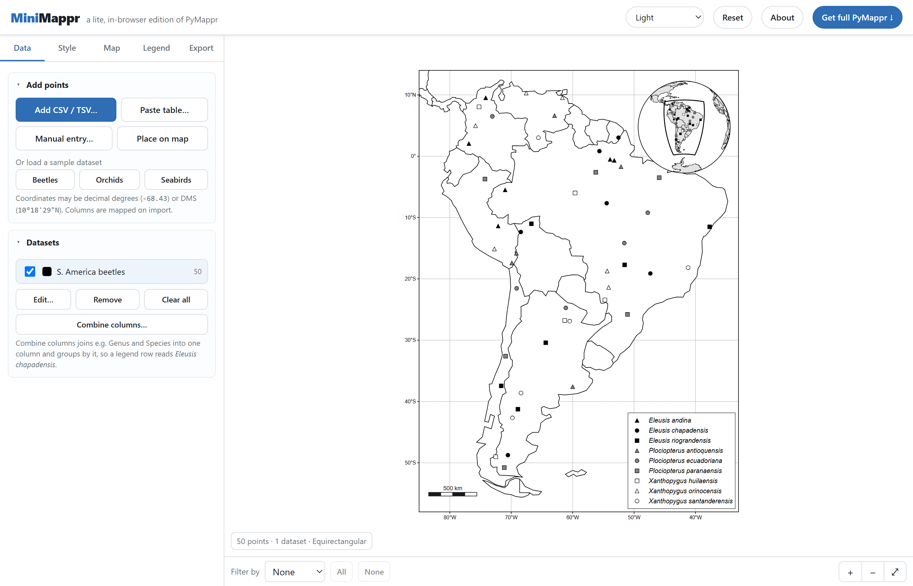

# MiniMappr

**MiniMappr** is the browser-only edition of [PyMappr](https://github.com/CalebHendren/PyMappr),
at [calebhendren.github.io/PyMappr](https://calebhendren.github.io/PyMappr/). It covers the core
workflow of turning a table of localities into a publication map, with nothing to install.

This is the `minimappr` branch of the PyMappr repository. GitHub Pages serves it from
[`index.html`](index.html). The desktop app, PyMappr, is on `main`, and its Rust port, RustyMappr,
is on `rustymappr`.



## What it has

- **Points:** from a CSV/TSV (with a column-mapping step), a pasted table, manual entry, or
  click-to-place, in decimal degrees or DMS.
- **Styling:** group, colour and symbol, with Combine columns and the filter bar.
- **Projections:** the same as PyMappr's, which are Equirectangular, Mercator, Robinson,
  Mollweide, Natural Earth, Winkel Tripel, the orthographic Globe, and regional and custom
  Lambert.
- **Map furniture:** the same legend options, scale bar, compass and grid as PyMappr.
- **Inset map:**
  - It shows either a locator or a close-up. A locator shows the country at the map's centre,
    the area around it, a continent or the world; a close-up shows a custom area.
  - A box links the inset to the main map.
  - The State/province region needs outlines that MiniMappr does not carry.
- **Publication style:** a one-click style matching PyMappr's Standard preset: black and white,
  a plain italic legend, and 17 cm wide at 600 DPI.
- **PyMappr's look:** line widths, markers and text are set in points at the print width. The
  map on screen is the printed figure scaled down, and the export comes out at that size whatever
  the window.
- **Export:** PNG, JPEG, WebP, TIFF, PDF or SVG, at the DPI you choose.
- **Reset:** the button in the header removes every dataset and puts all settings back to their
  defaults, after asking first.

## What it leaves out

- the ~30 Natural Earth layers;
- the relief and Blue Marble basemaps;
- bathymetry;
- labels;
- Excel import;
- project files;
- Python/R code export.

The page is self-contained: D3, d3-geo-projection, topojson-client and a simplified world outline
are all inlined.

## Development

```bash
python minimappr/build.py          # rebuild index.html from minimappr/
python -m pytest tests/            # MiniMappr's tests
```

- `minimappr/app/` holds the scripts, `minimappr/body.html` the page body,
  `minimappr/template.html` the shell and `minimappr/styles.css` the styles. `minimappr/data/`
  holds the world outline and the samples, and `minimappr/vendor/` the inlined libraries.
- `minimappr/build.py` inlines everything into `index.html`, which is committed: Pages serves it
  as is.
- Changes reach this branch by pull request. Since MiniMappr has no releases, it has no version
  number to bump.

## Data credits

MiniMappr uses a simplified, Natural Earth-derived world outline from
[world-atlas](https://github.com/topojson/world-atlas) (public domain). It is rendered with
[D3](https://d3js.org) and d3-geo-projection and decoded with topojson-client, all ISC licensed.

## Support me

If MiniMappr is useful to you, you can support its development on Ko-fi:
[**ko-fi.com/calebhendren**](https://ko-fi.com/calebhendren)

## Citation

Citing it is not necessary, but it is welcome:

> Hendren, Caleb. *PyMappr* [computer software].
> https://github.com/CalebHendren/PyMappr
> https://doi.org/10.5281/zenodo.21522496
